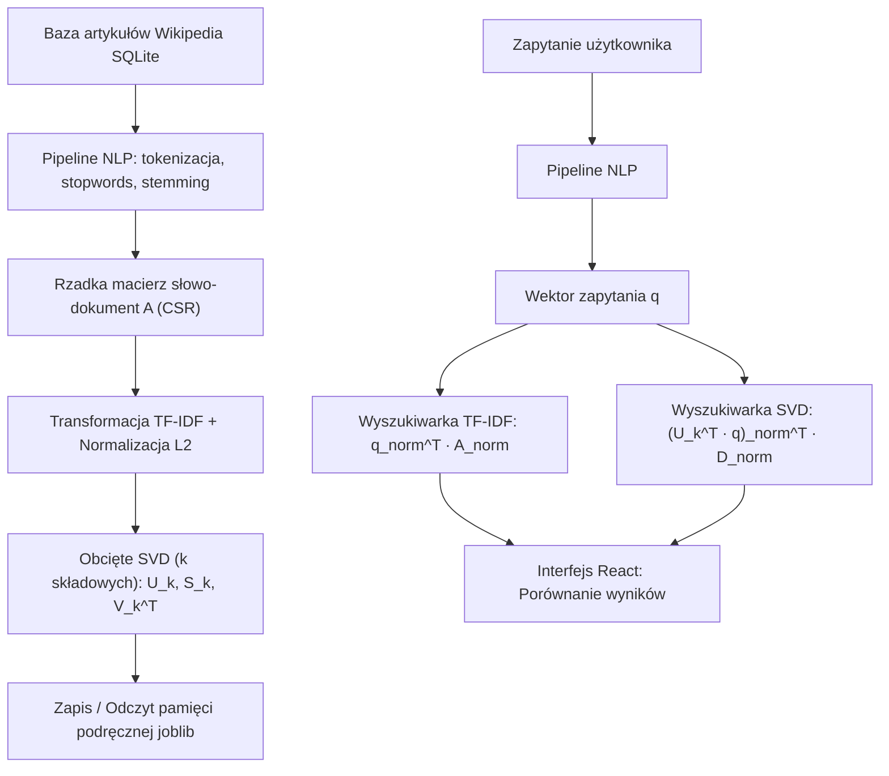

# Semantyczna Wyszukiwarka Wikipedii (LSA / SVD vs. TF-IDF)


Aplikacja implementuje i porównuje dwie metody wyszukiwania informacji:
1. **Model klasyczny (TF-IDF)** – wektorowy model dopasowania słów kluczowych z wagami częstości odwrotnej dokumentów i metryką cosinusową.
2. **Model semantyczny (LSA / SVD)** – utajona analiza semantyczna wykorzystująca obcięty rozkład według wartości osobliwych (*Truncated Singular Value Decomposition / Low-Rank Approximation*), która wychwytuje synonimy i relacje kontekstowe między pojęciami.

---

## Spis treści
- [Główne cechy](#-główne-cechy)
- [Architektura i zasada działania](#-architektura-i-zasada-działania)
  - [1. Przetwarzanie wstępne tekstu](#1-przetwarzanie-wstępne-tekstu)
  - [2. Macierz częstości i TF-IDF](#2-macierz-częstości-i-tf-idf)
  - [3. Redukcja wymiarowości (SVD / LSA)](#3-redukcja-wymiarowości-svd--lsa)
  - [4. Miara podobieństwa cosinusowego](#4-miara-podobieństwa-cosinusowego)
- [Struktura projektu](#-struktura-projektu)
- [Wymagania i instalacja](#-wymagania-i-instalacja)
  - [Krok 1: Backend (Flask)](#krok-1-backend-flask)
  - [Krok 2: Frontend (React + Vite)](#krok-2-frontend-react--vite)
- [Interfejs API](#-interfejs-api)
- [Konfiguracja](#-konfiguracja)
- [Badania i eksperymenty (Jupyter Notebook)](#-badania-i-eksperymenty-jupyter-notebook)

---

## Główne cechy

- **Asynchroniczny crawler Wikipedii (`crawler.py`)**: pobieranie losowych artykułów z angielskiej Wikipedii do lokalnej bazy danych SQLite z wykorzystaniem semaforów asynchronicznych.
- **Wydajne macierze rzadkie (`scipy.sparse.csr_matrix`)**: optymalna reprezentacja pamięciowa korpusu składającego się z setek tysięcy dokumentów i dziesiątek tysięcy słów.
- **Szybkie wyszukiwanie semantyczne**: jednorazowe obliczenie bazy $U_k$ oraz zredukowanych wektorów dokumentów i ich serializacja za pomocą `joblib`.
- **Równoległe porównanie w czasie rzeczywistym**: interfejs webowy prezentujący obok siebie wyniki TF-IDF oraz SVD wraz z wartościami miary podobieństwa.
- **Wbudowany czytnik artykułów**: możliwość podejrzenia pełnej treści wybranego artykułu bezpośrednio z poziomu aplikacji.

---

## Architektura i zasada działania



### 1. Przetwarzanie wstępne tekstu
Każdy dokument poddawany jest procesowi oczyszczania:
- zamiana liter na małe (`lowercase`),
- tokenizacja słów za pomocą `nltk.word_tokenize`,
- usunięcie znaków interpunkcyjnych oraz słów ze stop-listy języka angielskiego (`nltk.corpus.stopwords`),
- sprowadzenie wyrazów do rdzenia za pomocą algorytmu Portera (`PorterStemmer`),
- odfiltrowanie słów występujących zbyt rzadko (np. $\le 3$ razy w całym korpusie).

### 2. Macierz częstości i TF-IDF
Korpus $n$ dokumentów i słownik $m$ unikalnych słów tworzą macierz częstości $A \in \mathbb{R}^{m \times n}$.
W celu zredukowania wpływu słów powszechnych zastosowano ważenie **TF-IDF**:
$$\text{IDF}_t = \ln\left(\frac{N}{\text{DF}_t + \varepsilon}\right)$$
gdzie $N$ to całkowita liczba dokumentów, a $\text{DF}_t$ to liczba dokumentów zawierających term $t$. Następnie każda kolumna dokumentu jest normalizowana w normie $L_2$.

### 3. Redukcja wymiarowości (SVD / LSA)
Wyznaczany jest obcięty rozkład według wartości osobliwych (*Truncated SVD*):
$$A \approx A_k = U_k \Sigma_k V_k^T$$
- $U_k \in \mathbb{R}^{m \times k}$ – wektory własne przestrzeni pojęć (słów),
- $\Sigma_k \in \mathbb{R}^{k \times k}$ – wagi wartości osobliwych,
- $V_k^T \in \mathbb{R}^{k \times n}$ – współrzędne dokumentów w nowej przestrzeni $k$-wymiarowej.

Nowe reprezentacje dokumentów obliczane są jako $D_k = \Sigma_k V_k^T$, a zapytanie $q$ jest rzutowane na tę samą przestrzeń:
$$q_k = U_k^T q$$

### 4. Miara podobieństwa cosinusowego
Podobieństwo między zapytaniem a dokumentami mierzone jest cosinusem kąta między wektorami:
$$\text{CosineSimilarity}(\vec{u}, \vec{v}) = \frac{\vec{u} \cdot \vec{v}}{\|\vec{u}\|_2 \|\vec{v}\|_2}$$
Dzięki wcześniejszej normalizacji wektorów $L_2$, operacja sprowadza się do szybkiego mnożenia macierzowego:
$$\text{scores} = \vec{q}_{\text{norm}}^T \cdot M_{\text{norm}}$$

---

## Struktura projektu

```text
Lab6/
├── backend/
│   ├── data/                   # Katalog na bazę SQLite i plik cache joblib (ignorowane w git)
│   ├── database/
│   │   ├── crawler.py          # Asynchroniczny skrypt pobierający artykuły z Wikipedii
│   │   └── data_fetcher.py     # Pobieranie artykułów z bazy SQLite
│   ├── logic/
│   │   ├── text_preprocessing.py # Oczyszczanie, tokenizacja i stemming tekstu
│   │   ├── math_logic.py       # Macierz CSR, TF-IDF, SVD, wyszukiwanie
│   │   └── processed_data.py   # Serializacja i deserializacja stanu (joblib)
│   ├── app.py                  # Główny serwer Flask (REST API)
│   ├── config.py               # Parametry konfiguracyjne (K_FACTOR, ścieżki)
│   └── requirements.txt        # Zależności bibliotek w Pythonie
├── frontend/
│   ├── src/
│   │   ├── App.jsx             # Komponent główny, routing, strona wyszukiwania i artykułu
│   │   ├── App.css             # Stylowanie interfejsu użytkownika
│   │   ├── main.jsx            # Punkt wejściowy React
│   │   └── index.css           # Globalne reguły CSS
│   ├── package.json            # Zależności i skrypty npm
│   └── vite.config.js          # Konfiguracja bundlera Vite
├── sprawozdanie.ipynb          # Eksperymenty laboratoryjne, wykresy i analiza wyników
├── .gitignore                  # Pliki i katalogi ignorowane w repozytorium
└── README.md                   # Niniejsza dokumentacja
```

---

## 🛠️ Wymagania i instalacja

### Wymagania wstępne
- **Python 3.10+**
- **Node.js 18+** oraz **npm**

---

### Krok 1: Backend (Flask)

1. Otwórz terminal w katalogu `backend/`:
   ```bash
   cd backend
   ```

2. Utwórz i aktywuj wirtualne środowisko:
   - **Windows (PowerShell):**
     ```powershell
     python -m venv venv
     .\venv\Scripts\Activate.ps1
     ```
   - **Linux / macOS:**
     ```bash
     python3 -m venv venv
     source venv/bin/activate
     ```

3. Zainstaluj wymagane pakiety:
   ```bash
   pip install -r requirements.txt
   ```

4. *(Opcjonalnie)* Jeśli nie posiadasz bazy danych `wikipedia.db`:
   ```bash
   python database/crawler.py
   ```

5. Uruchom serwer API:
   ```bash
   python app.py
   ```
   > Serwer domyślnie nasłuchuje na porcie `http://localhost:5000`. Przy pierwszym uruchomieniu zostanie zbudowana i zapisana macierz `search_engine.joblib`. Przy kolejnych startach dane wczytują się błyskawicznie z pliku cache.

---

### Krok 2: Frontend (React + Vite)

1. Otwórz drugi terminal i przejdź do katalogu `frontend/`:
   ```bash
   cd frontend
   ```

2. Zainstaluj biblioteki JavaScript:
   ```bash
   npm install
   ```

3. Uruchom serwer deweloperski:
   ```bash
   npm run dev
   ```

4. Otwórz w przeglądarce adres wskazany w konsoli (zazwyczaj `http://localhost:5173`).

---

## 🔌 Interfejs API

Backend udostępnia dwa główne endpointy HTTP:

### 1. `POST /api/search`
Wyszukuje najbardziej pasujące artykuły według metryki klasycznej oraz SVD.

- **Request Body:**
  ```json
  {
    "query": "quantum physics",
    "k": 5
  }
  ```
- **Response (200 OK):**
  ```json
  {
    "tfidf": [
      { "title": "Quantum mechanics", "score": 0.4812 },
      { "title": "Wave function", "score": 0.3541 }
    ],
    "svd_LRA": [
      { "title": "Quantum mechanics", "score": 0.5218 },
      { "title": "Schrödinger equation", "score": 0.4439 }
    ]
  }
  ```

### 2. `POST /api/article`
Pobiera pełną treść wybranego artykułu z bazy danych.

- **Request Body:**
  ```json
  {
    "title": "Quantum mechanics"
  }
  ```
- **Response (200 OK):**
  ```json
  {
    "content": "Quantum mechanics is a fundamental theory in physics..."
  }
  ```

---

## Konfiguracja

W pliku [`backend/config.py`](backend/config.py) można dostosować parametry silnika wyszukiwania:

| Parametr | Domyślna wartość | Opis |
|---|---|---|
| `K_FACTOR` | `300` | Liczba składowych SVD (rząd aproksymacji niskorzędowej). |
| `MAX_DOCS` | `300_000` | Maksymalna liczba artykułów ładowana do macierzy słowo-dokument. |
| `DB_PATH` | `data/wikipedia.db` | Ścieżka do bazy danych SQLite zawierającej artykuły. |

---

## Badania i eksperymenty (Jupyter Notebook)

W pliku [`sprawozdanie.ipynb`](sprawozdanie.ipynb) zawarto szczegółową analizę eksperymentalną:
- Badanie wpływu zastosowania wag **IDF** na jakość wyników (eliminacja faworyzowania powszechnych słów),
- Wpływ rzędu aproksymacji $k$ na zdolność uogólniania i odnajdywania relacji semantycznych dla $k \in \{50, 100, 150, 200, 1000, 2000\}$,
- Zestawienie czasów obliczeniowych budowy macierzy i rozkładu SVD.
